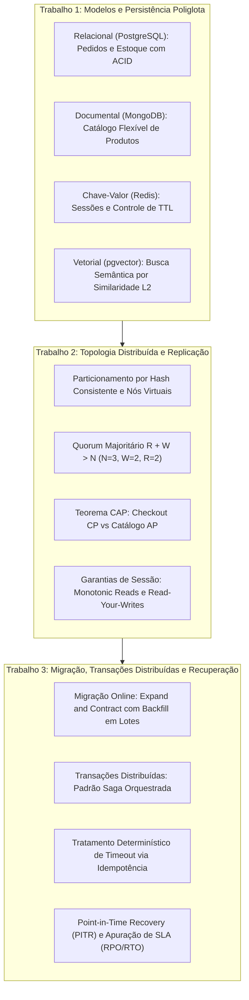

# Loja Horizonte — Persistência de Dados e Bancos Distribuídos

> **Pós-Graduação em Arquiteturas de Soluções Escaláveis**  
> **Autor:** Rodolfo Delfini  
> **Estudo de Caso:** Loja Horizonte  
> **Escopo:** Projeto de Persistência Poliglota, Topologia Distribuída e Resiliência Operacional

---

## 1. Visão Geral da Arquitetura

O projeto desenvolve a arquitetura de dados e persistência do marketplace **Loja Horizonte**, abordando os desafios de modelagem, distribuição física, tolerância a falhas e continuidade de negócios por meio de Registros de Decisão de Arquitetura (ADRs):

$$\mathbf{Decisão} + \mathbf{Justificativa} + \mathbf{Evidência\ Prática} + \mathbf{Trade\text{-}off}$$



---

## 2. Estrutura do Repositório

O projeto está organizado em módulos correspondentes a cada fase de evolução arquitetural:

```text
├── t1-modelos/                        # Trabalho 1: Persistência Poliglota
│   ├── RELATORIO_T1.md                # Relatório técnico de decisões arquiteturais
│   ├── README.md                      # Roteiro de reprodução e comandos
│   ├── docker-compose.yml             # Manifesto de infraestrutura local
│   ├── sql/                           # DDL, seeds e transação atômica com RETURNING
│   ├── mongo/                         # Seed do catálogo em documentos JSON
│   ├── redis/                         # Comandos de chave-valor e TTL
│   └── scripts/t1_demo_completo.py    # Suíte executável de validação
│
├── t2-distribuicao/                   # Trabalho 2: Topologia Distribuída
│   ├── RELATORIO_T2.md                # Relatório técnico de distribuição e quórum
│   ├── README.md                      # Roteiro de execução das simulações
│   └── scripts/
│       ├── 01_anel_hash_consistente.py       # Sharding modular vs Anel consistente
│       ├── 02_quorum_e_cap_simulador.py      # Quórum majoritário e bifurcação CAP
│       └── 03_garantias_sessao_simulador.py  # Anomalias de replicação e token de sessão
│
└── t3-migracao-recuperacao/           # Trabalho 3: Operações Críticas e Resiliência
    ├── RELATORIO_T3.md                # Relatório técnico de migração, Sagas e PITR
    ├── README.md                      # Roteiro de testes
    ├── migracao/                      # Scripts V1, V2, Backfill particionado e V3
    ├── saga/                          # Máquina de estados executável da Saga
    └── recuperacao/                   # Simulação de PITR via WAL e cálculo de RPO/RTO
```

---

## 3. Síntese das Decisões de Persistência

A arquitetura implementada atende aos seis eixos fundamentais de persistência e sistemas distribuídos da disciplina:

1. **Modelo de Persistência e Invariantes:**  
   Adoção de persistência poliglota — PostgreSQL (ACID) para pedidos e integridade estrita de estoque (`disponivel >= 1`), MongoDB para catálogo flexível sem migrations de DDL, Redis em memória para sessões com expiração automática por TTL e pgvector para busca semântica aproximada.

2. **Topologia Distribuída e Particionamento:**  
   Emprego de Anel de Hash Consistente com nós virtuais para divisão homogênea de lojistas sem sobrecarga de migração em expansões, aliado à replicação Líder-Seguidores com Quórum Majoritário ($N=3, W=2, R=2$).

3. **Garantias de Consistência de Leitura:**  
   Mitigação do atraso de replicação assíncrona (*replication lag*) através de roteamento por versão mínima observada da sessão (*token de sessão*), eliminando regressões temporais (*Monotonic Reads*) e assegurando a visibilidade das próprias alterações (*Read-Your-Writes*).

4. **Evolução de Schema com Zero Downtime:**  
   Aplicação do padrão *Expand-and-Contract* suportado por gatilho transacional síncrono e rotina de *Backfill* particionado em lotes controlados com cursor incremental, viabilizando a convivência de versões da aplicação sem bloqueios prolongados de tabela.

5. **Coordenação Transacional Distribuída:**  
   Implementação de Saga Orquestrada com ações compensatórias idempotentes para reversão de falhas financeiras, combinada com tratamento determinístico de respostas desconhecidas (*timeouts*) por meio de chaves de idempotência estáveis.

6. **Continuidade de Negócio e Recuperação de Incidentes:**  
   Estratégia de *Point-in-Time Recovery* (PITR) baseada em base backup físico e arquivamento contínuo de logs de transação (WAL), com parada granular anterior ao incidente e apuração formal de métricas de SLA (RPO e RTO).

---

## 4. Instruções de Execução

Todas as suítes de validação podem ser executadas a partir da raiz do repositório:

```bash
# Validação do Trabalho 1 (Modelos e Invariantes)
python t1-modelos/scripts/t1_demo_completo.py

# Validação do Trabalho 2 (Topologia, Quórum e Replicação)
python t2-distribuicao/scripts/01_anel_hash_consistente.py
python t2-distribuicao/scripts/02_quorum_e_cap_simulador.py
python t2-distribuicao/scripts/03_garantias_sessao_simulador.py

# Validação do Trabalho 3 (Migração Online, Saga e Recuperação)
python t3-migracao-recuperacao/migracao/03_backfill_em_lotes.py
python t3-migracao-recuperacao/saga/orquestrador_saga.py
python t3-migracao-recuperacao/recuperacao/simular_pitr_wal.py
python t3-migracao-recuperacao/recuperacao/calculo_rpo_rto.py
```
